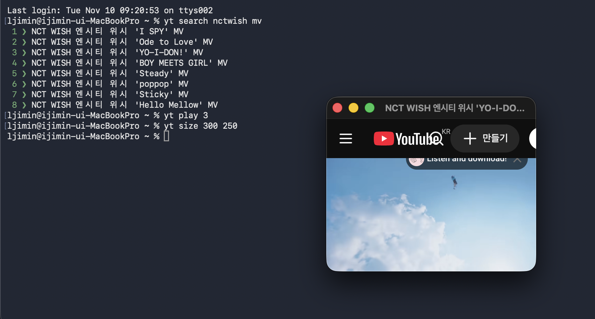

# YouTube Terminal

macOS 터미널에서 YouTube 영상을 검색하고, 작은 플레이어 창으로 재생할 수 있는 CLI 도구입니다.

작업 중 영상을 보기 위해 브라우저를 크게 띄우는 것이 번거로워 개인적인 용도로 만들었습니다. 
이 프로젝트는 only 바이브코딩으로 제작하였습니다. 간단한 명령어와 최소한의 출력에 집중했습니다.

## 실행 화면



## 주요 기능

- 터미널에서 영상 검색 및 번호로 선택해 재생
- 이전·다음 검색 결과 이동
- 일시정지 및 재생 제어
- 플레이어 창 크기 조절 및 설정 유지, 숨기기, 다시 표시, 닫기
- 검색 결과와 오류 메시지 중심의 간결한 출력

## 실행 환경

- macOS
- Python 3
- Google Chrome (`/Applications`에 설치)
- `yt-dlp` (영상 검색용)

## 설치

```bash
git clone https://github.com/YOUR_USERNAME/youtube-terminal.git
cd youtube-terminal
```


저장소를 내려받은 뒤 프로젝트 폴더에서 실행합니다.

```bash
brew install yt-dlp
chmod +x install.sh
./install.sh
source ~/.zshrc
```

`install.sh`는 `yt` 명령어를 `~/.local/bin`에 설치하고, 필요하면 해당 경로를 `~/.zshrc`에 추가합니다.

## 사용 방법

```bash
yt search 검색어  # 영상 검색
yt play 3              # 세 번째 검색 결과 재생
yt size 300 250        # 창 크기 조절
yt pause               # 일시정지 토글
yt resume              # 재생 상태 토글
yt next                # 다음 검색 결과
yt prev                # 이전 검색 결과
yt hide                # 창 최소화
yt show                # 창 다시 표시
yt close               # 창 닫기
yt help                # 명령어 도움말
```

`yt play`는 YouTube 영상 URL이나 11자리 영상 ID도 받을 수 있습니다.

## 동작 방식

Python으로 명령어를 처리하고 `yt-dlp`로 검색 결과를 가져옵니다. 선택한 영상은 Google Chrome의 일반 YouTube 페이지를 별도 창으로 열어 재생합니다. 창 크기와 표시 상태는 macOS AppleScript를 통해 제어합니다.

## 참고 사항

- macOS 전용 개인 프로젝트입니다.
- Chrome의 최소 창 크기 및 YouTube 페이지 UI가 그대로 적용됩니다.
- `pause`와 `resume`은 현재 영상의 재생 상태를 확인하는 방식이 아니라 키보드 단축키 `k`를 전송하는 **토글 방식**입니다. macOS 손쉬운 사용 권한이 필요할 수 있습니다.
- Chrome 창과 탭 상태, YouTube 사이트 변경에 따라 일부 명령이 동작하지 않을 수 있습니다.
- 검색 결과 및 마지막 재생 상태는 사용자 홈 디렉터리의 `~/.yt-mini-native/`에 저장됩니다. 이 폴더는 저장소에 포함되지 않습니다.

## 라이선스

별도의 오픈소스 라이선스를 적용하지 않았습니다.

### 창 재사용 및 크기 저장

`yt play`와 `yt next`/`yt prev`는 기존 플레이어 창을 재사용합니다. `yt size 300 250`으로 지정한 크기는 사용자 설정 파일에 저장되어 다음 실행에도 적용됩니다. 창을 닫았다가 다시 열어도 마지막 크기를 사용합니다.
